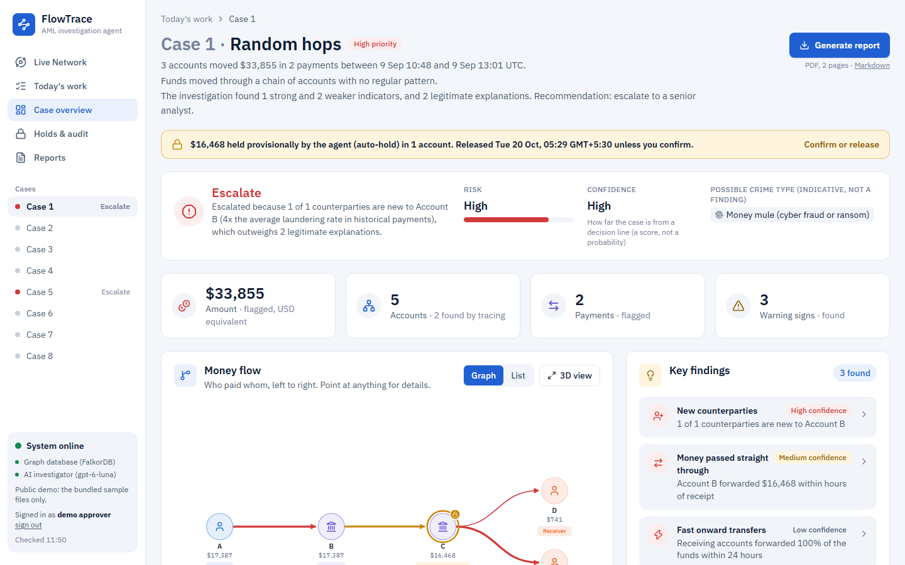
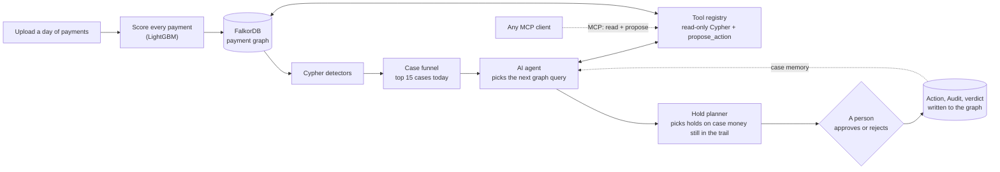
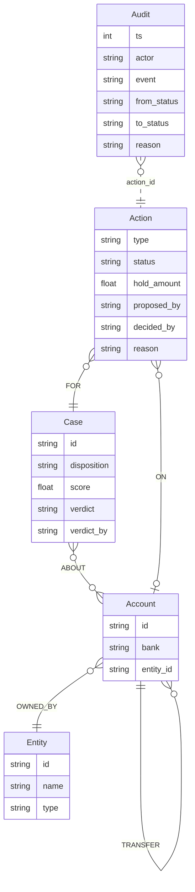

<div align="center">

# FlowTrace

**Catches mule money in a payment graph and freezes it before it's cashed out.**

[](https://flowtrace.omsharma.dev)
[](<VIDEO_LINK>)
[](https://www.falkordb.com)
[](https://www.wemakedevs.org/hackathons/falkordb)
[](#mcp-any-agent-can-investigate-only-a-person-approves)
[](LICENSE)

### [▶ Demo video](<VIDEO_LINK>) · [🌐 Live demo](https://flowtrace.omsharma.dev)

</div>



<sub>Case 1 on the live app: the agent traced the money, escalated the case, and held the $16,468 still in the last
account. A person confirms or releases it.</sub>

## The problem

A **money mule** is an account that receives stolen or dirty money and quickly passes it on, so the trail goes cold.
Mule money often leaves within hours, long before an analyst opens the alert. And analysts drown in alerts: one day
in our test data has **654,467 payments**, and only 0.08% of them are laundering.

## What FlowTrace does

| | Step | In one line |
|---|---|---|
| 🔎 | **Find** | Scores every payment, finds laundering shapes with Cypher, and ranks the cases for one analyst's day. |
| 🧭 | **Investigate** | An AI agent picks its own graph queries, follows the money hop by hop, and checks for salary or rent that would explain it. |
| 🔒 | **Act** | The agent proposes a **hold** (a freeze on an amount, never a whole account) on only the case money still in the trail. A person confirms or releases every hold, with a written reason. Every decision is audited. |
| 🧠 | **Remember** | Cases, actions and human verdicts are saved in the graph, so the next investigation knows which accounts were escalated before. |

**Act is the core.** The agent only freezes money that is still there. When it is very sure (Escalate at a confidence
score of 0.9 or more), it holds **provisionally**, and the hold is released after 1 business day unless a person
confirms it. It never files an **STR** (a Suspicious Transaction Report to the country's financial intelligence unit)
by itself. That is always a person's decision.

## How it works



The LLM chooses the next tool and writes the report. It never runs its own Cypher and never sets the decision: risk,
the decision (Escalate / Review / Close) and the holds are computed in code. Details:
[docs/architecture.md](docs/architecture.md).

## See it work

All screenshots are from the real app on the curated sample day (2,271 payments).

| | |
|---|---|
|  **Today's work.** 40 flagged payments become 17 cases; the top 15 are today's work. |  **Case overview.** Key findings with confidence, and the money flow from sender to destination. |
|  **Live investigation.** Each step streams in: what the agent checked, why, and what it found. |  **The agent acts.** It proposes holds. The bar shows money frozen now, still in the trail, and already gone. |
|  **A person decides.** Approve or reject needs a name and a written reason. |  **Holds & audit.** Holds with live countdowns, and the append-only audit log. |
|  **PDF case report.** Two pages for an analyst or compliance officer. [Sample PDF](docs/sample-report.pdf). |  **Live Network.** Every payment in 3D, with the agent's money trace drawn as it runs. |

## Why a graph

- **Money trails are multi-hop and time-ordered.** Money can only move on after it arrived, so the trace is a graph
  walk with a time rule on every hop.
- **Context lives in connections.** The agent finds the shortest path from a case to accounts that were escalated
  before, and asks whether several accounts send money to the same place.
- **The graph is the memory.** Case, Action and Audit nodes sit next to the accounts they are about, so every new
  investigation reads past decisions.

Without the graph there is no trace, no holds and no memory. FlowTrace does not work without FalkorDB.

## Results

Measured on Sep 9, a held-out test day.

| What | Result |
|---|---|
| Finding the right cases (full day, 654,467 payments) | **15 of 15**: the top 15 cases are all laundering |
| Freezing the money (eval slice, 21 laundering cases) | **98.6%**: the holds freeze $5.59M of the $5.67M of laundering money still in the trail |
| The LLM agent vs the rules (agent evaluation, eval slice, 19 legitimate cases) | Legitimate cases escalated: **5 of 19** (LLM) vs 16 of 19 (rules) |

**Limitation:** choosing *where* to hold is no better than chance. 61% of holds land on real laundering accounts,
against a 64% base rate. So the agent only proposes, or holds provisionally, and a person always decides. Every
number, method and caveat: [docs/evaluation.md](docs/evaluation.md).

## Graph data model



- `TRANSFER` edges carry `tx_id`, `ts` (epoch ms, range-indexed), `amount` (USD), `cur` and `batch`.
- Action `type` is HOLD, RELEASE, ESCALATE, FILE_STR or CLOSE; `status` is PROPOSED, PROVISIONAL, APPROVED, REJECTED
  or EXPIRED. Audit nodes are only ever created, never changed.
- Laundering labels are never written to the graph, so the agent cannot read the answer. Full model:
  [docs/queries.md](docs/queries.md).

## The Cypher it depends on

Five of the queries, shortened. Every agent tool runs through `GRAPH.RO_QUERY`, so FalkorDB itself blocks writes.

```cypher
// Trace one hop forward: money can only move on after it arrived
MATCH (a:Account) WHERE a.id IN $ids
UNWIND $frontier AS f
WITH a, f WHERE f.id = a.id
MATCH (a)-[t:TRANSFER]->(b:Account)
WHERE t.ts + 0 >= f.ts AND t.ts + 0 <= f.ts + $max_gap_ms AND NOT b.id IN $visited
RETURN a.id AS src, b.id AS dst, t.tx_id AS tx_id, t.amount AS amount
ORDER BY amount DESC, tx_id LIMIT 200
```

```cypher
// Pass-through: money comes in and a similar amount leaves to someone else soon after
MATCH (a:Account) WHERE a.id IN $ids
MATCH (a)<-[i:TRANSFER]-(s)
WHERE i.ts + 0 >= $t0 AND i.ts + 0 < $t1 AND s.id <> a.id AND i.amount >= $min_amount
MATCH (a)-[o:TRANSFER]->(d:Account)
WHERE o.ts + 0 >= i.ts AND o.ts + 0 <= i.ts + $gap AND o.ts + 0 >= $day0 AND o.ts + 0 < $t1
  AND d.id <> a.id AND d.id <> s.id AND o.amount >= i.amount * $lo AND o.amount <= i.amount * $hi
RETURN a.id AS account, count(o) AS pairs
```

```cypher
// Shared destinations: do several case accounts pay the same place?
MATCH (s:Account) WHERE s.id IN $ids
MATCH (s)-[t:TRANSFER]->(d)
WHERE t.ts + 0 >= $t0 AND t.ts + 0 < $t1 AND NOT d.id IN $ids
WITH d, count(DISTINCT s) AS senders, sum(t.amount) AS total
WHERE senders >= 2
RETURN d.id AS dst, senders, total ORDER BY senders DESC, total DESC, dst LIMIT 20
```

```cypher
// Case memory: how close is this account to an earlier escalated case? A person's verdict wins
MATCH (a:Account {id: $id}), (c:Case)-[:ABOUT]->(x:Account)
WHERE coalesce(c.verdict, c.disposition) = 'ESCALATE' AND x.id <> a.id
  AND NOT c.id STARTS WITH $batch_prefix AND c.created_ts < $t0
WITH a, c, x
MATCH p = allShortestPaths((a)-[:TRANSFER*1..3]-(x))
RETURN x.id AS account, c.id AS case_id, min(length(p)) AS hops ORDER BY hops LIMIT 5
```

```cypher
// A person decides: only an open action changes, and the audit entry is written in the same query
MATCH (a:Action {id: $id}) WHERE a.status IN ['PROPOSED', 'PROVISIONAL']
WITH a, a.status AS was
SET a.status = $to, a.decided_by = $by, a.decided_at = $now, a.reason = $reason
CREATE (:Audit {id: $audit_id, ts: $now, actor: $by, event: $to, action_id: a.id,
                from_status: was, to_status: $to, reason: $reason})
```

All queries in full: [`queries.py`](backend/flowtrace/graph/queries.py),
[`alerts.py`](backend/flowtrace/detectors/alerts.py) and [docs/queries.md](docs/queries.md).

## MCP: any agent can investigate, only a person approves

The same tools are an MCP server at `https://flowtrace.omsharma.dev/mcp`. The read-only tools (`list_cases`,
`trace_funds`, `plan_holds` and more) are public. `propose_action` needs the approver token, and there is no approve
tool: only a person in the app can approve.

```bash
claude mcp add --transport http flowtrace https://flowtrace.omsharma.dev/mcp
# or: npx @modelcontextprotocol/inspector  (transport: Streamable HTTP)
```

Try: *"list the cases, then plan holds for the top one"*. Local setup for Claude Desktop:
[docs/architecture.md](docs/architecture.md#mcp-server).

## Quick start

Runs locally with Docker on the demo history graph. No dataset download needed.

```bash
git clone https://github.com/justomsharma/flowtrace
cd flowtrace
cp .env.example .env                        # optional: OPENAI_API_KEY (else the rule-based agent), APPROVER_TOKEN (to approve)
docker compose --profile app up -d --build  # FalkorDB + the app; loads the demo history graph on first start
start http://localhost:8000                 # macOS: open, Linux: xdg-open. Then Today's work, Try the sample day
```

Full setup (the IBM dataset, training, the full graph, every evaluation, tests): [docs/setup.md](docs/setup.md).
How the demo graph was reduced to fit FalkorDB Cloud: [docs/demo-history.md](docs/demo-history.md). Deploy:
[docs/deploy.md](docs/deploy.md). 3-minute demo script: [docs/demo.md](docs/demo.md).

## Tech stack


## Team

- **Om Sharma** ([@justomsharma](https://github.com/justomsharma))
- **Genga K** ([@Genga28](https://github.com/Genga28))

Built for **GraphHacks** (WeMakeDevs × FalkorDB, Oct 15–18, 2026), **Track 1: Agents That Act on Connected Data**.

## AI assistance

AI coding assistants (Claude Code) were used to build FlowTrace. The team reviewed every change and understands
every part: the graph model, the queries, the architecture and each decision. At runtime, FlowTrace calls an LLM
(OpenAI `gpt-6-luna` by default; Anthropic Claude via `LLM_PROVIDER=anthropic`) to choose investigation steps and
write case reports. Facts, scores and decisions are computed in code.

## Data & license

- **Code:** MIT ([LICENSE](LICENSE)).
- **Data:** IBM *Transactions for Anti Money Laundering* (HI-Small), which is **synthetic**: no real customer data.
  The data in `data/` is derived from it under CDLA-Sharing-1.0 ([data/LICENSE](data/LICENSE),
  [data/NOTICE](data/NOTICE)).
