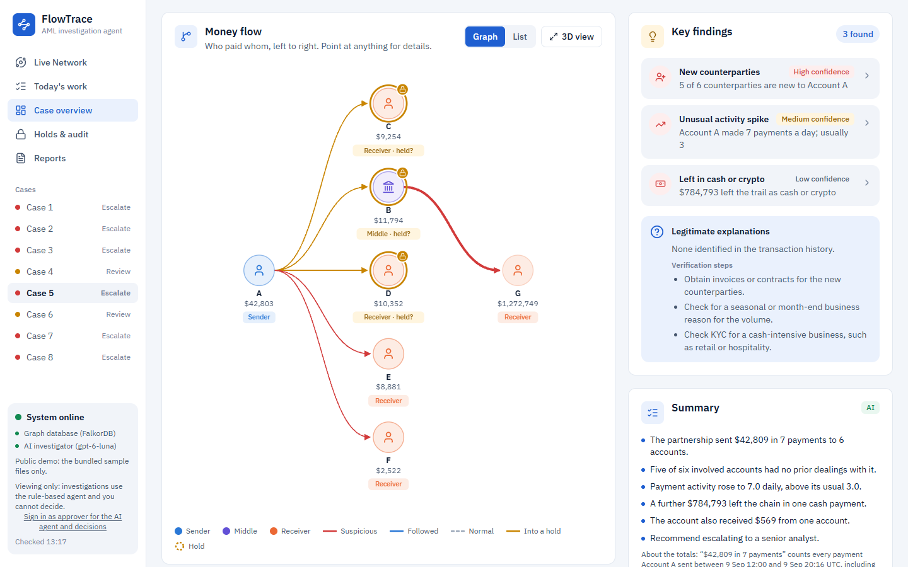
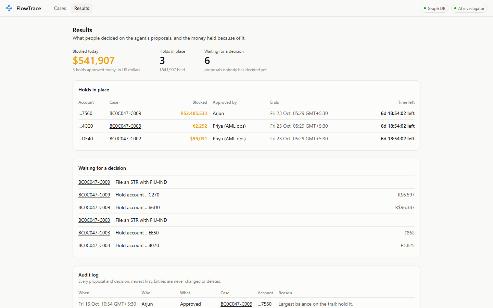
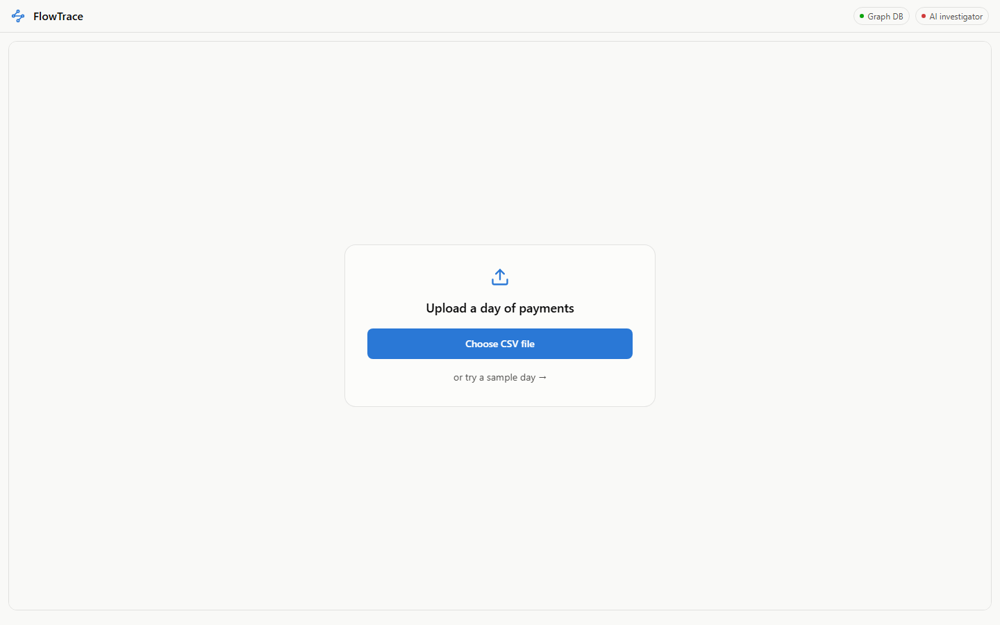
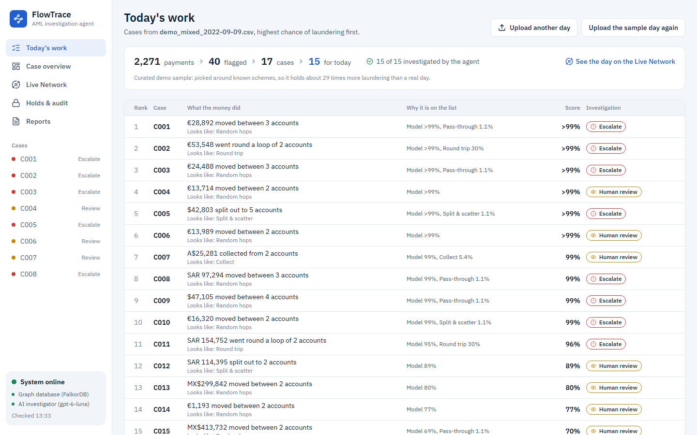
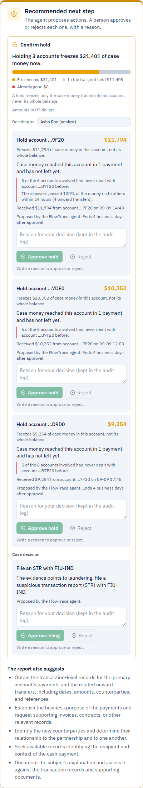
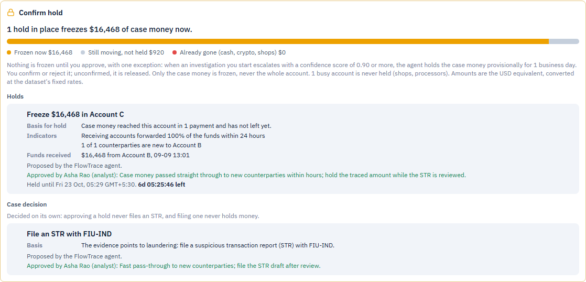
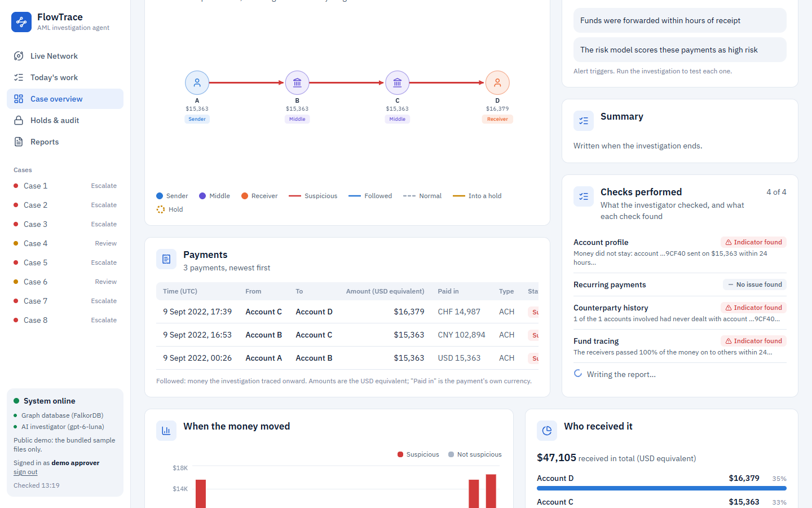
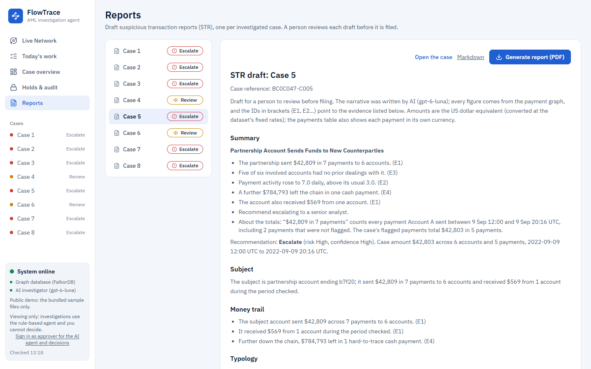
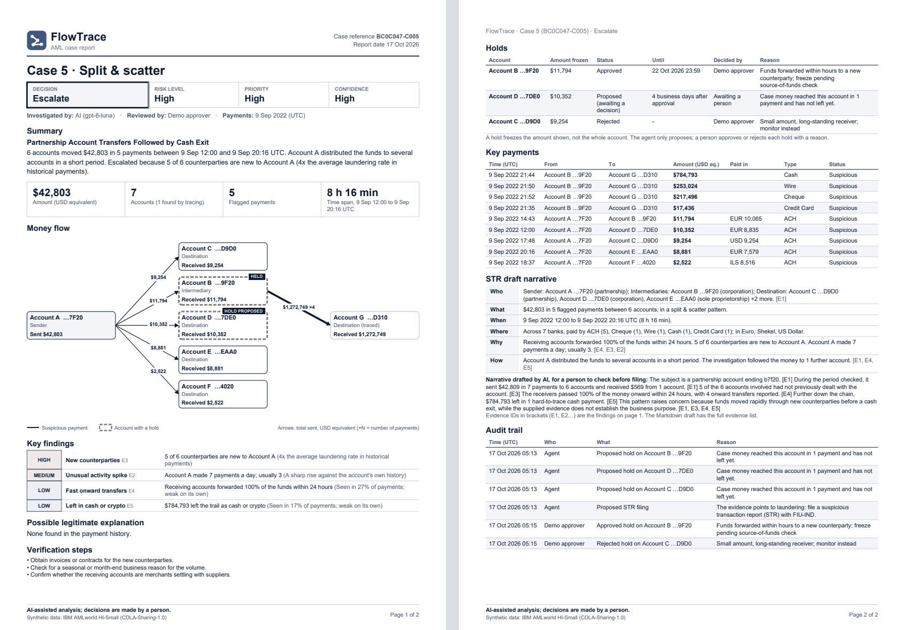
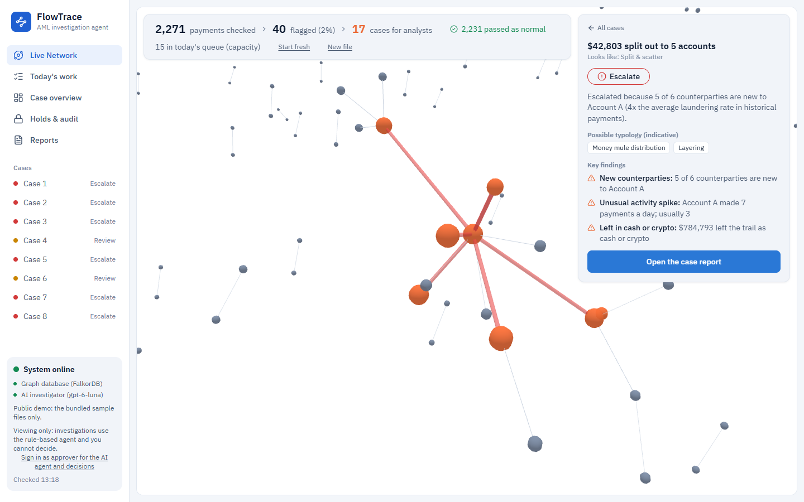

# FlowTrace

**Live demo: https://flowtrace.omsharma.dev**. Anyone can look around and investigate with the rule-based agent.
The LLM agent and approvals need the demo approver token (ask the team). [3-minute demo script](docs/demo.md) · MCP endpoint: `https://flowtrace.omsharma.dev/mcp`
(streamable HTTP) · [How it is deployed](docs/deploy.md). The graph runs on FalkorDB Cloud's free tier, which has
**no TLS** (`FALKORDB_TLS=false`): the connection needs a password but is not encrypted.

FlowTrace is an AML (anti-money-laundering) agent that acts on a FalkorDB transaction graph. Upload a day of
payments, and it does five things:

1. scores every payment;
2. finds laundering shapes with Cypher;
3. groups the suspicious payments into cases, ranked for one analyst's day;
4. investigates a case the way an analyst would. The agent picks its own graph queries: it follows the money hop
   by hop, checks whether two accounts ever paid each other before, and looks for salary or rent patterns that would
   explain the payments;
5. **acts**. It plans which accounts to hold, freezing only the case money that is still in the trail. When it is
   confident, it holds that money provisionally. A person confirms or releases every hold, with a written reason,
   and an append-only audit log records each step.

The same tools are an MCP server, so any agent can investigate a case. An agent can propose actions; only a person
can approve them.

| Case page: the agent's hold, waiting for a person | Holds & audit |
|---|---|
|  |  |

**Run it locally** with Docker, on the demo history (no dataset download needed):

```bash
git clone https://github.com/justomsharma/flowtrace
cd flowtrace
cp .env.example .env                        # optional: OPENAI_API_KEY (else the rule-based agent), APPROVER_TOKEN (to approve)
docker compose --profile app up -d --build  # FalkorDB + the app; loads the demo history graph on first start
start http://localhost:8000                 # macOS: open, Linux: xdg-open. Then Today's work, Try the sample day
```

The full setup (the IBM dataset, training, the full 3.6M-transfer graph and every evaluation) is under *Setup*.

---

## About

The main idea: **rules catch patterns; FlowTrace explains them, and closes the ones a human analyst would close.** A salary that is split into EMIs, rent and card bills looks like "fan-out + pass-through" to a rule. FlowTrace recognises it from the graph.

Built for **Graph Hacks: Context for AI Agents** (WeMakeDevs × FalkorDB, Oct 15–18, 2026).
**Track:** Track 01, Agents That Act on Connected Data.

---

## Screenshots

All screenshots are from the real app on the curated sample day (`demo_mixed_2022-09-09.csv`), at laptop width.

**1. Upload a day of payments**, or try the sample day. The steps show while the file is processed.



**2. Today's work.** 2,271 payments become 40 flagged payments and 17 cases. The 15 with the highest chance of laundering are today's work; the other 2 are folded under *Lower priority*. The agent investigates the top 15 in the background. The sidebar lists the top cases with a dot for their disposition, and "System online" comes from `/api/health` (graph database and AI investigator). This is the curated demo sample; full-day numbers are in *Results*.



**3. Case overview.** One page per case:
- **Header:** the case, its laundering shape and a priority from the case score. *Generate report* downloads the two-page PDF case report (the STR draft is a small *Markdown* link under it).
- **Four figures:** the amount involved, accounts connected, red flags found, and the investigation status (Queued, Investigating, Escalate, Review or Close).
- **Transaction flow**, left to right. Each account's role comes from the flow itself: no money in = sender, no money out = destination, otherwise intermediary. Red arrows are suspicious payments, amber arrows carried case money into a proposed hold, and the amber ring marks the hold (dashed = proposed, solid = approved).
- **Key findings:** one row per red flag, with a confidence badge from the evidence weight (thresholds in `config.yaml`, `ui.evidence_confidence`). Under them, the legitimate explanations the agent found.
- **Verdict card:** risk and confidence as High / Medium / Low, at the thresholds in `config.yaml` (`disposition.escalate_at`, `close_below`, `confidence_labels`). The confidence score measures distance from a decision line; it is not a probability, so no percentage is shown. Escalated cases also show a *possible crime type (indicative, not a finding)*.

Every amount is the **USD equivalent** (the dataset's payments in other currencies are converted at its fixed rates), and each payment row also shows the payment in its own currency (EUR, SAR, BRL…).


**4. The agent acts: recommended next step.** After an escalation, the agent proposes which accounts to hold. A hold freezes only the case money traced into an account, never its whole balance. The headline is the money frozen now. The bar splits the case money into frozen now, still in the trail, and already gone (cash, crypto, another currency or a merchant). Every hold, and the case decision (here: file an STR), waits for a person. Nothing starts ticked, and holds and the case decision are approved or rejected separately. A proposed hold shows when it would end before anyone approves it.



**5. A person decides.** Approve or Reject needs the person's name (asked once) and a written reason, and the server checks its approver token. An approved hold shows who approved it, why, and a live countdown to its automatic release.



**6. Live investigation.** The agent's steps stream onto the case page as it works: what it checked, why, and what it found. The stepper maps the case to its real states: alert received, scored, graph investigation, report, analyst review.



**7. Holds & audit.** Money frozen today, holds in place with live countdowns, proposals waiting for a decision, and the append-only audit log, filtered by what needs you. Amounts are the USD equivalent.


**8. Reports.** The STR draft of every investigated case, built from the report, the evidence, the proposed actions and what people decided. It downloads as Markdown.



**The PDF case report.** *Generate report* (case page or Reports page) downloads a PDF of at most two A4 pages, for an
analyst or a compliance officer:
- **Page 1, the case at a glance:** the decision (Escalate / Review / Close) with risk, priority and confidence; who
  investigated it (the AI model or the rules) and who reviewed it; a short summary; amount, accounts, payments and
  time span; the money flow (Sender to Intermediary to Destination, amounts on the arrows, holds dashed); the key
  findings with High / Medium / Low confidence, and the possible legitimate explanation.
- **Page 2, actions and evidence:** the holds (amount frozen, status, until when, who decided, why), the largest
  payments with their own currency, the STR narrative (who / what / when / where / why / how) with evidence IDs, and
  the latest audit entries.

It is built from the case page's own overview, so the numbers match. Long lists end with "+N more", and each page is
shrunk to fit, so it never runs to a third page. It prints well in black and white. It is made in Python with
reportlab (no browser, no system packages). Sample: [docs/sample-report.pdf](docs/sample-report.pdf) (case 5 of the
curated demo day, with one hold approved, one rejected and one still proposed).



**9. Live Network.** The 3D map of every payment in the file, with the open case highlighted and the agent's money trace drawn as it runs. *View full graph* on a case opens it here.



---

## Results (measured; reproduce with the commands below)

| What | Result | How it was measured |
|---|---|---|
| Triage model, Precision@100 | **97%** | Of the 100 highest-scored transfers on held-out test days (Sep 9–10), 97 are labelled laundering |
| Triage model, F1 (laundering class) | **0.515** (P 0.65, R 0.43, PR-AUC 0.51) | Same held-out days. Accuracy is 99.91%, but flagging nothing already scores 99.89%, so accuracy is not used to judge the model |
| Laundering-shape recognition | **96.5%** on 282 schemes with 3+ accounts; 80.8% on all 370 | Against IBM's ground-truth pattern file. Schemes with 1–2 transfers are inherently ambiguous |
| Strongest legitimacy signal | First-time account pairs launder at **1.69%**; pairs with >10 prior transfers at **0.018%** (92× lower) | Whole HI-Small dataset |
| Case funnel, **full test day** (Sep 9, 654,467 payments, 0.08% laundering) | **280 flagged → 186 cases**, largest 9 accounts; **15 of the top 15 cases are laundering**; of 121 schemes active that day, 18 are in the top 15, 49 in the top 50, 93 in some case | `python -m flowtrace.eval.fullday --day 2022-09-09`: offline, every payment, no graph upload, detectors not run (see *How flagging works*). Validation days: 168 and 176 cases, 22 of 117 and 22 of 116 schemes in the top 15 |
| Case funnel, **full test day** (Sep 10, 208,325 payments, 0.21% laundering) | **262 flagged → 180 cases**, largest 7 accounts; **15 of the top 15 cases are laundering**; of 124 schemes active that day, 18 are in the top 15, 51 in the top 50, 86 in some case | `python -m flowtrace.eval.fullday --day 2022-09-10`: same offline method as Sep 9 |
| Case funnel, **curated demo sample** (Sep 9, 2,271 payments, 2.3% laundering, ~29× a real day) | 40 flagged → 17 cases, largest 6 accounts; 14 of the top 15 cases are laundering; 18 of 26 schemes in the top 15 | `python -m flowtrace.eval.funnel ../data/samples/demo_mixed_2022-09-09.csv`. The sample is hand-picked around known schemes for the demo, so it reads far better than a real day |
| Adaptive agent vs fixed workflow, **Sep 9 eval slice** (40 cases: 21 laundering, 19 legitimate) | Escalate recall **1.00 / 1.00 / 0.67** and precision **0.58 / 0.57 / 0.74** (fixed / heuristic / llm); legitimate cases escalated 15 / 16 / 5 of 19; no laundering case closed; 0.5% of the LLM report's claims unsupported | Same alerts, same query budget, final test after the scoring was chosen on Sep 7–8; see *Evaluation* |
| Hold planner, **Sep 9 eval slice** (top 40 ranked cases), laundering cases (21) | With rule-based dispositions, holds **freeze $5.59M** of the $5.67M of case money still in the trail; 61% of the 41 holds are on accounts that really launder, against a **64% base rate**; on legitimate cases the proposals would wrongly freeze **$98.3M** if approved. With the LLM's dispositions: **$5.51M** frozen, 57% vs 64%, and **$47,796** wrongly frozen | `python -m flowtrace.eval.holds --sample eval/day_slice_2022-09-09.csv --cases 40 [--policy llm]`. Full table and caveats in *Acting on a case* |

For comparison, published results on HI-Small are 62.9 F1 for GFP+LightGBM and 68.2 for Multi-PNA, on a different split that includes the Sep 11–18 tail. We exclude that tail (see *Data*).

---

## Architecture

```
CSV batch ─► parse ─► triage model (LightGBM) ─► load into FalkorDB ─► Cypher detectors ─► cases
                                                                                        │
                       ┌────────────────────── investigation loop (≤ 6 steps) ◄─────────┘
                       │  policy picks an approved tool ─► read-only Cypher ─► evidence ledger
                       │  (the LLM, or rules, or the fixed baseline)      risk re-scored each step
                       └─► deterministic disposition ─► senior-analyst report ─► validator ─► case memory in graph
                                                                                        │
                       act: hold planner (lien on the traced case money) ─► PROPOSED actions in the graph
                            ─► a person approves or rejects with a reason ─► audit trail, verdict back into case memory
```

The same tools are served over **MCP** (`python -m flowtrace.mcp.server`), so Claude Desktop or any MCP client can investigate cases and propose actions.

- **Backend:** Python, FastAPI, Server-Sent Events, FalkorDB (Python client), polars, LightGBM, networkx, OpenAI SDK (Anthropic optional)
- **Frontend:** React, Vite, TypeScript, Tailwind, Recharts, a hand-drawn SVG flow graph (layered layout), 3d-force-graph (three.js), vitest
- **LLM:** OpenAI `gpt-6-luna` by default (Responses API, strict JSON-schema output), chosen for low latency and cost. It chooses the next tool and writes the report. It never computes facts, never runs its own Cypher, and never sets the disposition.

---

## Graph data model (FalkorDB)

```
(:Entity {id, name, type})                      owner: Corporation, Partnership, Sole Proprietorship, Individual
(:Account {id, bank, entity_id, entity_type, self_cnt})-[:OWNED_BY]->(:Entity)
(:Account)-[:TRANSFER {tx_id, ts, amount, fmt, cur, xcur, batch?}]->(:Account)
(:Case {id, disposition, typology, crime_hypothesis, score, confidence, created_ts, summary, tx_ids, expires_ts,
        verdict?, verdict_by?, verdict_at?, verdict_reason?})
      -[:ABOUT]->(:Account)                     case memory written after each investigation; verdict = a person's decision
(:Action {id, type, status, case_id, account?, hold_amount, on_routes, currency, rate, why, evidence_ids, tx_ids,
          expiry_days, expires_ts, proposed_by: 'agent'|'mcp', proposed_at, decided_by, decided_at, reason, dedup_key})
      -[:FOR]->(:Case), -[:ON]->(:Account)      type HOLD|RELEASE|ESCALATE|FILE_STR|CLOSE; status PROPOSED|APPROVED|REJECTED|EXPIRED
(:Audit {id, ts, actor, auth?, event, action_id, case_id, account, from_status, to_status, reason})   only ever created
```

- `ts` is stored as an integer in epoch milliseconds, with a range index on it. `amount` is in USD, converted at fixed rates derived from the data.
- Indexes: `Account.id`, `Entity.id`, and `TRANSFER(ts, tx_id)`.
- Labels (`Is Laundering`) are **never written to the graph**, so nothing the agent reads can leak ground truth.
- The graph holds history before the test days; the loader records where it ends (`(:Meta {id: 'history', until})`), and uploads with payments before that are refused, since those payments are already in the graph. Uploaded batches are merged in as `TRANSFER` edges tagged with a batch id. Payment ids are a hash of the payment's own fields and the batch id is a hash of the file, so uploading the same (or an overlapping) file again adds nothing.

## Cypher and graph algorithms the product depends on

Every query lives in two files: [`backend/flowtrace/graph/queries.py`](backend/flowtrace/graph/queries.py) and [`backend/flowtrace/detectors/alerts.py`](backend/flowtrace/detectors/alerts.py).

| Purpose | Query |
|---|---|
| Alert detectors | `FAN_OUT`, `FAN_IN`, `PASS_THROUGH`, `SCATTER_GATHER` (2-hop, time-ordered), `CYCLE` (`[:TRANSFER*2..4]` with `ALL()` time-order predicate) |
| Money tracing | `TRACE_FORWARD_HOP` / `TRACE_BACKWARD_HOP`. One query per hop, so each wave streams to the UI. Money can only move on after it arrived (`t.ts >= f.ts`), and tracing stops at hub accounts (`DEGREES`) |
| Legitimacy evidence | `PAIR_HISTORY_OUT/IN` (relationship age and count), `FLOW_SERIES` (payment series per counterparty → recurring-payment detection), `CP_INFO` (owner type and degree), `SIBLING_ACCOUNTS` (same owner) |
| Baseline | `ACCOUNT_DAILY_HISTORY` (robust z-score against the account's own history) |
| Network shape | `SHARED_DESTINATIONS` / `SHARED_SOURCES`, `CYCLES` |
| Case memory | `SAVE_CASE`, `PRIOR_CASES`, `NEAREST_ESCALATED` (`shortestPath` to escalated accounts). Both read `coalesce(c.verdict, c.disposition)`, so a person's verdict replaces the agent's, and human verdicts come first |
| Hold planner | `TRACE_FORWARD_HOP` from the case accounts, `HUB_DEGREES` + `DEGREES_UNTIL` (hub rules, payments before the decision only), `HOLD_FLOWS` (what each trail account received and sent after the case money arrived) |
| Actions | `PROPOSE_ACTION` (dedup and the per-case hold cap checked in the same write; audit entry only when created), `DECIDE_ACTION` (`WHERE a.status = 'PROPOSED'`, so a second click changes nothing), `EXPIRE_DUE`, `EXPIRE_PROPOSALS` + `RETIRE_DECIDED` (re-upload), `AUDIT_LOG`. The decision, its verdict, an approved release and withdrawing the case's other open decisions happen in one query |

FalkorDB specifics we rely on:
- **`GRAPH.RO_QUERY`:** every agent tool is read-only, enforced by the database.
- **Per-query timeouts.**
- **Edge counting:** every query references the `TRANSFER` variable (e.g. `count(t)`), because FalkorDB otherwise counts parallel edges between the same two accounts only once.
- **Literal `LIMIT`s**, because `LIMIT` cannot take a parameter.

**`algo.maxFlow`.** FalkorDB 6.0.2 has it (checked with `CALL dbms.procedures()`), along with BFS, WCC, PageRank, betweenness, harmonic centrality, label propagation, MSF and shortest paths. The hold planner does not use it for its context figure (the minimum vertex cut of the trail):
- it returns a flow, not a cut;
- it has no node capacities;
- it runs over stored edges, so time order, node splitting and a super-source would mean writing a temporary network into the graph.

The trail is small (a few hundred accounts at most), so the planner reads it with read-only Cypher and computes the cut in networkx. Holds are liens on amounts, so the cut doesn't choose them (see *Acting on a case*).

**Without FalkorDB the product does not work:** detection, investigation, tracing, legitimacy checks and case memory are all graph queries.

---

## How flagging works

1. **Triage model.** LightGBM on 37 point-in-time features: amount, format, relationship history, same-day fan-in/out and pass-through, 2-hop scatter-gather, reciprocal flows, entity type. Features only use data up to the end of the transfer's day, which matches end-of-day batch monitoring.
   The raw score is **calibrated** to a probability of laundering (isotonic regression on the validation days, stored in `config.yaml` as `calibration`).
2. **Cypher detectors** fire on typology shapes in the batch window. **PASS-THROUGH** is time-paired: money comes in and a similar amount (0.8–1.05×) leaves to someone else within 24 hours, for incoming payments of at least $1,000 (FATF 2023 cyber-fraud indicators; FinCEN FIN-2014-A005 funnel accounts). Each detector carries its **measured precision** on the validation days (`detectors.precision`), shrunk toward the pooled rate of all detectors so a detector with few hits cannot look perfect. On full days these are low (FAN-OUT 1%, FAN-IN 5%, PASS-THROUGH 1%, SCATTER-GATHER 11%, CYCLE 30%), so detectors mainly explain cases rather than create them.
3. **Cases** ([`cases.py`](backend/flowtrace/pipeline/cases.py)):
   - **One bar for every signal.** A payment opens a case when its calibrated probability, or the precision of a detector that fired on it, reaches `cases.flag_probability` (0.5). Weaker detector hits are attached to open cases as evidence.
   - **Suspect-centred grouping.** Cases grow outward from the riskiest accounts over flagged payments. **Hubs** (degree in the `cases.hub_lookback_days` = 6 days before the batch ≥ `cases.hub_degree`, the 99th percentile of a 6-day window = 70) never join two cases or lead one; their payments stay in the case of the other account. A case stops growing at `cases.max_accounts` (30).
   - **Score.** `case_score = 1 − (1 − model probability) · Π(1 − detector precision)` over the distinct detectors in the case: the chance that at least one signal is right (assumes independence). No hand-picked weights.
   - **Capacity.** Cases are ranked by `case_score`. The top `cases.daily_capacity` (15) are *Today's work*; the rest are listed as *Lower priority*. Nothing is hidden. This is recall at fixed investigator capacity, the way Google Cloud AML AI backtests. On a full day about 180 cases open; the 15 worked first are all laundering, and the rest stay listed below.
   - Each case's shape is classified (FAN-OUT, FAN-IN, SCATTER-GATHER, GATHER-SCATTER, CYCLE, BIPARTITE, STACK, RANDOM).
   - **Tuning.** `flag_probability` was chosen on the validation samples with a rule fixed before looking: 10–20 cases on both days, the most schemes in the top 15, the higher bar on ties.

     | Bar | Sep 7: cases / schemes in top 15 | Sep 8: cases / schemes in top 15 |
     |---|---|---|
     | 0.1 | 20 / 20 of 23 | 28 / 17 of 23 |
     | 0.3 | 17 / 20 | 23 / 17 |
     | **0.5** | **15 / 20** | **20 / 17** |
     | 0.6 | 13 / 18 | 20 / 17 |
4. **Investigation.** The agent gathers two kinds of evidence:
   - **Red flags:** new counterparties, equal splits, fast onward transfer, cash/crypto exit, round trips, activity spike, a dormant account becoming active, nearness to escalated cases.
   - **Legitimate explanations:** established counterparties, recurring flows with an inferred purpose (payroll, fixed obligation/EMI, bill, standing order), payments to high-volume receivers, activity consistent with the account's baseline, internal transfers between the same owner's accounts, money that stops moving.
   - Some red flags are **escalators**: they halve the weight of legitimate explanations.
5. **Disposition** is computed in code from the evidence ([`disposition.py`](backend/flowtrace/agent/disposition.py)):
   `risk = 0.45·model + 0.35·red_flags + 0.20·shape − 0.40·legitimacy`
   - **ESCALATE** at risk ≥ 0.55.
   - **CLOSE** at risk < 0.25, but only if legitimate explanations are strong and no escalator fired. A closure expires after 90 days.
   - **REVIEW** for everything else.
6. **Report.** The LLM writes the senior-analyst report from the evidence ledger. A validator drops any statement that cites unknown evidence, or uses numbers that are not in the cited evidence. The unsupported-claim rate is reported for every case.

All thresholds and weights live in [`config.yaml`](config.yaml).

**Crime type.** The dataset labels laundering yes/no only. The "possible predicate crime" maps the observed shape to the crimes the data generator models (extortion, loan sharking, gambling, prostitution, kidnapping, robbery, embezzlement, drugs, smuggling), plus the few indicators with a well-supported link (`crime_by_indicator`: money returning to its sender -> embezzlement, money forwarded straight on -> money mule). Splits, cash or crypto, many sources and convergence are left out: they are common in normal accounts. It is a **hypothesis**, labelled *indicative*, shown for escalated cases only, and is not a measured prediction.

---

## Acting on a case: holds a person approves

An investigation ends with a recommendation. Then the agent acts: it plans which accounts to hold and proposes those holds, along with the case decision. **The agent proposes. Only a person can approve or reject, and they must give a reason. Nothing is frozen until a person approves, with one exception, the auto-hold below.**

**Auto-hold** (`actions.auto_hold`, on by default; decided by measurement, see *Measurement*). It acts only when **all** of these hold:
- `actions.auto_hold.enabled` is on **and** the API server has an `APPROVER_TOKEN` (so a person can confirm or release);
- an investigation **a person started** has just finished (never a background prefetch or re-queue, never a manual re-plan, never MCP) and recommends **ESCALATE with a confidence score of 0.9 or more** (`min_confidence`; a score, not a probability);
- the planner found a hold, no hold of the case was ever decided (approved, rejected, released or expired), and no analyst gave the case a verdict, so a release or a CLOSE is never undone.

The hold is **PROVISIONAL**, audited as `agent (auto-hold)`. A person confirms it (it then runs its normal term) or rejects it (released now). If nobody confirms it within **1 business day** (`confirm_business_days`) it is released automatically. It never files an STR or escalates. The UI states this exception wherever it says "Nothing is frozen until you approve", and only when it is active on the server.

How FlowTrace holds money, and what it is based on:
- **A hold freezes an amount, never a whole account.** It is a lien on the case money traced into an account. This follows the RBI [draft KYC Amendment Directions, Sep 2026](https://rbi.org.in/scripts/BS_PressReleaseDisplay.aspx?prid=63587), which allow a debit hold on the suspected amount for at most 60 days. Indian High Courts have also limited liens to the disputed amount.
- **How long a hold lasts is a policy setting:** `actions.hold_expiry_business_days`, 4 business days by default. After that the hold is released automatically.
- **For comparison only:** the UK FCA's [FG24/6](https://www.fca.org.uk/publication/finalised-guidance/fg24-6.pdf) lets the payer's bank delay **one outbound payment** for up to 4 business days. That rule is about single payments. It is not an account hold, and FlowTrace does not cite it as one.
- **AML vendors** (Unit21, Lucinity, Feedzai) show the same split: the AI recommends, a person decides, and an audit trail records every decision.

**Hold planner** ([`actions/planner.py`](backend/flowtrace/actions/planner.py)). It is deterministic and uses no LLM.
1. **Trail.** It traces the money forward in time from the case accounts, and adds the case's own flagged payments. It stops at the end of the case window: that is the decision time, and nothing after it is used.
   - Some payments are **exits**: cash or crypto, a payment in another currency (the data's stand-in for cross-border), or a payment to a hub. Money that took an exit is **already gone**.
2. **Hold amount.** For each account on the trail, the hold amount is the smaller of two figures:
   - the money at rest in the account since the case money arrived (money in minus money out);
   - the case money traced into it.

   So a busy company that is a case account holds only its flagged money, never its day's receipts. The sum over the trail is the **case money still in the trail**.
3. **Which holds.** The planner picks the accounts that freeze the most money, with these limits:
   - at most `actions.max_holds_per_case` (3) holds per case;
   - none below `actions.min_hold_usd` ($1,000);
   - never a hub, by any of the existing hub rules. Hub status counts only payments before the decision time.

   When two accounts hold the same amount, it picks the one that also sits on more of the case's routes.
4. **The headline is "frozen now":** what the holds freeze today.
5. **"On the case's routes" is an assumption, reported separately.** It is money resting upstream whose every route seen so far passes a held account. It counts only if the mules don't pay someone new. The planner still computes a minimum vertex cut of the trail network, but only as context: how many *account-wide* freezes would cut every route. A lien on an account with nothing in it freezes nothing, so the cut doesn't choose the holds.
6. **Holds only after ESCALATE.** REVIEW means mixed evidence, which is below "reasonable grounds to suspect", so REVIEW only proposes a senior look. *This rule was decided after seeing the Sep 9 results* (before that, REVIEW cases got holds too).

**Actions and audit** ([`actions/service.py`](backend/flowtrace/actions/service.py)):
- **Proposals.** Proposals are keyed on case, type and account, so a double click or a re-plan never creates a second action. The per-case cap of 3 holds is checked in the same write, so two callers racing each other can't go over it. Each proposal records where it came from: `agent` (the app) or `mcp` (an outside AI client).
- **Decisions.** Approve and reject need a written reason, the approver's name, and the server's `APPROVER_TOKEN` in the `X-Approver-Token` header. The audit log records the name and how the approver was checked. The same `Idempotency-Key` returns the first answer; any other second decision gets a 409.
- **What a decision changes, all in one query:**
  - **Approving FILE_STR, ESCALATE or CLOSE** writes the person's verdict on the Case node, and withdraws the case's other open case decisions.
  - **Approving CLOSE** (the case is legitimate) also withdraws the case's proposed holds and releases its approved holds.
  - **Approving a RELEASE** ends that hold.
- **Append-only audit.** Audit entries are only ever created. No query changes or deletes one.
- **Case memory.** `PRIOR_CASES` and `NEAREST_ESCALATED` prefer a person's verdict over the agent's, and keep the `created_ts < $t0` rule.

**API:**
- `POST /api/cases/{id}/plan` plans holds and proposes them. It needs a finished investigation, and it also runs automatically after each investigation.
- `GET /api/cases/{id}/plan` returns the plan, the actions, and what the open holds freeze now.
- `GET /api/actions?status=&case_id=` lists actions.
- `POST /api/actions/{id}/approve` and `/reject` take `{reason, by}`, the `X-Approver-Token` header, and an optional `Idempotency-Key`.
- `GET /api/audit?case_id=&limit=` returns the audit trail.
- `GET /api/cases/{id}/overview` returns everything the case page shows, built from the stored case, result and hold plan plus a read-only listing of the case's actions (it never writes, so polling it is safe): figures, the flow with account roles, timeline, amount distribution, payments, findings, summary and investigation status.
- `GET /api/cases/{id}/report.md` downloads the STR draft as Markdown (409 until the case is investigated).
- `GET /api/cases/{id}/report.pdf` downloads the case report as a PDF of at most two pages, built from the same
  overview (read-only, 409 until the case is investigated).

**One tool registry** ([`agent/registry.py`](backend/flowtrace/agent/registry.py)):
- **Read-only tools** (GRAPH.RO_QUERY): the investigation tools, `get_case`, `list_cases` and `plan_holds`.
- **One write tool**, `propose_action`, with the same checks for every caller:
  - a hold only after ESCALATE, only on an account on the trail, and never on a hub;
  - only for at least the minimum amount, and only within the cap;
  - a RELEASE only of an approved hold.
- The in-app agent, the app's act step and the MCP server all use this one registry.

### MCP server

[`backend/flowtrace/mcp/server.py`](backend/flowtrace/mcp/server.py) uses the official Python SDK (`mcp` 2.x, `MCPServer`).
- **Read-only tools:** `account_profile`, `counterparty_history`, `recurring_flows`, `trace_funds`, `shared_counterparties`, `find_cycles`, `owner_network`, `case_memory`, `get_case`, `list_cases`, `plan_holds`. They are annotated `read_only_hint`, and their Cypher runs through GRAPH.RO_QUERY, so FalkorDB itself rejects a write.
- **One write tool:** `propose_action`. Its proposals are recorded as `proposed_by: "mcp"`, and the confirm panel shows "Proposed by an outside AI client (MCP)".
- **It can't approve.** There is no approve tool, and the standalone process drops `APPROVER_TOKEN` from its environment at startup, so it never holds the approver token.
- **Hosted.** The API also serves the same server at `/mcp` (streamable HTTP), so a client can use the live demo's tools: `https://flowtrace.omsharma.dev/mcp` (for example in the MCP Inspector: `npx @modelcontextprotocol/inspector`, transport *Streamable HTTP*). Mounted there, no tool approves either; only the API's approve endpoints, behind the approver token, do. On the public demo every MCP request counts toward a per-visitor limit, and `propose_action` also needs the approver token in an `X-Approver-Token` header.
- **Sessions.** Investigation tools keep one context per case for the session, so an account found by `trace_funds` can be profiled next.

```bash
cd backend
python -m flowtrace.mcp.server             # stdio (Claude Desktop, IDEs, most clients)
python -m flowtrace.mcp.server --http      # streamable HTTP on http://127.0.0.1:8765/mcp
```

The server needs FalkorDB and the cases the app saved (`data/runs`), but not the API.

**Claude Desktop.** Edit the config file, then restart Claude Desktop. Do **not** add `APPROVER_TOKEN` to it.
- Windows: `%APPDATA%\Claude\claude_desktop_config.json`
- macOS: `~/Library/Application Support/Claude/claude_desktop_config.json`

```json
{
  "mcpServers": {
    "flowtrace": {
      "command": "C:\\path\\to\\flowtrace\\venv\\Scripts\\python.exe",
      "args": ["-m", "flowtrace.mcp.server"],
      "cwd": "C:\\path\\to\\flowtrace\\backend",
      "env": { "PYTHONPATH": "C:\\path\\to\\flowtrace\\backend" }
    }
  }
}
```

**Any other MCP client.** Run the same command over stdio, or point the client at an HTTP endpoint (local or the live demo's). Try: "list the cases, then plan holds for the top one".

### Measurement (honest)

How the measurement works:
- **Which cases.** The **top 40 ranked cases** of the Sep 9 eval slice, and every case of the curated sample.
- **Dispositions** come from the rule-based investigation (deterministic, no LLM), or with `--policy llm` from the LLM agent (one run; it is not deterministic). Holds are planned only after ESCALATE, as in the app.
- **Correct hold.** A hold counts as correct when its account sent or received a labelled laundering payment **before the decision time**.
- **Base rate.** The same share among *every* account a hold could have gone on (the planner's candidates), shown next to the precision.
- **Fixed in advance.** The config values (cap, minimum, expiry) were set before the first run. The two later method changes were decided after seeing Sep 9:
  - holds only after ESCALATE;
  - a lien on the traced amount instead of the account's balance.
- **Currency.** Amounts are the US dollar equivalent.

| | Sep 9 slice: 21 laundering cases | Curated sample: 17 cases (16 laundering) |
|---|---|---|
| Case money still in the trail | $5,669,216 (median case $31,763) | $813,787 |
| **Frozen now by the planned holds** | **$5,588,222 (98.6%)** | **$704,345 (86.6%)** |
| On the case's routes (assumption, not held) | $7,097 | $1,580 |
| Already gone (cannot be held) | $144,885 | $116,663 |
| Holds | 41, in 17 cases | 16, in 9 cases |
| Holds on accounts that really launder | 25 of 41 (61%) | 10 of 16 (62.5%) |
| Base rate among accounts a hold could go on | 37 of 58 (64%) | 15 of 21 (71%) |

**Cost: money wrongly frozen on legitimate cases** (Sep 9 slice, 19 legitimate cases), rule-based dispositions:
- The rule-based investigation escalates 15 of them.
- The planner proposes 14 holds that would freeze **$98,329,255** if a person approved them.
- $98.2M of that comes from two cases (C024 and C025). In each, the *flagged payment itself* is a single ACH of $77.3M or $20.9M into the case account. So a lien limited to the flagged amount is still that large, and only a person rejecting it prevents the cost.
- The other 12 holds come to $102,289.

**Rules vs LLM: whose escalation gates the holds** (Sep 9 slice, top 40 cases; the planner and the full graph are the same, only the disposition differs; measured from a clean graph on Oct 17):

| Dispositions from | Laundering cases escalated | **Frozen now** (laundering; $5,669,216 still in the trail) | Holds on accounts that really launder vs **base rate** | Legitimate cases escalated | **Wrongly frozen** if approved (legitimate) |
|---|---|---|---|---|---|
| rules (heuristic) | 21 of 21 | **$5,588,222** (98.6%), 41 holds in 17 cases | 25 of 41 (61%) vs 64% | 15 of 19 | **$98,329,255** (14 holds) |
| llm (gpt-6-luna) | 16 of 21 (5 sent to REVIEW) | **$5,505,124** (97.1%), 35 holds in 14 cases | 20 of 35 (57%) vs 64% | 7 of 19 | **$47,796** (7 holds) |

- **The LLM cuts the cost by more than 2,000×** ($98.3M to $47.8K) because it does not escalate C024 and C025, the two
  legitimate cases with one huge ACH payment each. It still freezes 97% of the laundering money still in the trail.
- **The 5 laundering cases it sends to REVIEW lose their holds** (holds follow ESCALATE only). This costs $83,098 of
  money that could have been frozen, and a person still sees each case.
- **Picking which account to hold is no better than the base rate under either policy** (61% and 57% vs 64%). The
  disposition decides *whether* to hold; the planner decides *where*, by amount.
- **Read with care:** one LLM run on 40 cases. The earlier agent eval of the same slice escalated 14 of 21 laundering
  and 5 of 19 legitimate cases, so expect a few cases to move between runs.

To reproduce, run `python -m flowtrace.eval.holds --sample eval/day_slice_2022-09-09.csv --cases 40` (add `--policy llm` for the LLM row) and `--sample demo_mixed_2022-09-09.csv`.
- Each run writes `data/models/holds_eval_*.json`.
- The planner only reads.
- The slice batch is uploaded and then deleted. The demo batch is left alone if the UI already uploaded it.

**Auto-hold, measured** (`flowtrace.eval.variants`, heuristic dispositions, the rule written before measuring: default on only with precision ≥ 90% on Sep 7–8 and no legitimate case with more than $1M frozen):

| | Validation, Sep 7–8 (80 cases) | Final test, Sep 9 (40 cases) |
|---|---|---|
| Cases it would auto-hold | 11, all laundering (100%) | 6, all laundering (100%) |
| Of their holds, on accounts that really launder | 60% | 69% |
| Money it would freeze | $1,078,269 | $4,958,624 |
| **Money wrongly frozen** (legitimate cases) | **$0** | **$0** |

So auto-hold is on by default. Read it with care: 11 of 11 still leaves a 95% lower bound of about 72% precision, and the scoring first pushed (variant B below) would have auto-frozen **$77.3M** on one legitimate Sep 9 case (C024).

What the numbers say:
- **The holds freeze most of the case money still in the trail** (98.6% and 86.6%), with at most 3 holds per case.
- **Picking by amount is no better than picking at random** among the holdable accounts: 61% vs a 64% base rate, and 62.5% vs 71%. The planner finds where the money is. It doesn't tell a mule from an innocent receiver.
- **The decision before the holds sets their cost.** The rule-based investigation escalated 15 of 19 legitimate cases on this slice, the LLM 7. This is why every hold waits for a person.
- **The hub rule costs some laundering.** In 2 slice cases and 3 curated cases, every case account is a hub (70+ payments in 6 days before the case), so those cases get no hold.
- **The samples are small and inflated.** About 50% of the slice's cases are laundering, and 94% of the curated sample's, against well under 1% of payments on a real day. With n = 40 and n = 17, one case moves a share by several points.

---

## Demo history graph (what the live demo runs on)

The full history graph (515,088 accounts, 3,641,261 transfers before Sep 9) takes about **2.7 GB** in FalkorDB.
FalkorDB Cloud's free tier has **100 MB**. Every query reads the history of only a few accounts, so the demo runs on
a reduced graph that keeps exactly that history: **25,916 accounts and 57,010 transfers, 54 MB** in FalkorDB
([`demo/history.py`](backend/flowtrace/demo/history.py), files in `data/demo/`).

**How it is built.** Each bundled sample and the Sep 9 eval slice are uploaded into the **full** graph, and every
query is recorded while:
- every case is investigated with the rule-based and fixed policies, and its holds are planned;
- for the bundled samples (what the public demo can upload), every agent tool runs at its widest on every case
  account: traces both ways at 4 hops, plus all account tools. The LLM picks its own steps; in 63 recorded LLM
  investigations every tool call was on a case account.

The demo graph keeps:
- every history transfer of every account a tool, the tracer or the planner asked about;
- every transfer a query returned;
- every transfer a detector matched.

Hub checks only compare a count with a threshold, so for a hub (for example three bank accounts with 7K–139K
transfers) it keeps just enough transfers to stay over each threshold. Scoring needs no graph: it reads the earlier
payments of the samples' accounts (`data/demo/processed`, 502K rows) with the same model (`data/demo/model`).

**Checked against the full graph** ([`demo/verify.py`](backend/flowtrace/demo/verify.py)). Both graphs start clean.
The samples are uploaded one after another, case memory is saved, every case is investigated, and every hold is
planned. Everything except timings is compared. The demo side also uses the demo scoring files and model.

| | Result |
|---|---|
| Cases for all 4 files (ids, accounts, payments, scores, shapes) | **identical** (63 cases) |
| Rule-based and fixed-workflow investigations, and their hold plans | **identical** for the bundled samples (44 of 44). On the eval slice, 81 of 82 match. In the other one (C024), the *case memory* step finds a *nearest escalated account* 3 hops away through history on the full graph, and not on the demo graph. No evidence, decision or hold changes. It happens only when the slice is uploaded after the samples, and the public demo can't upload the slice. |
| LLM investigations, replayed step by step on both graphs | **identical** for the bundled samples (22 of 22: evidence, decision, hold plan). On the eval slice, 37 of 41 match exactly. In the other 4, a backward trace or the case-memory lookup reaches history the demo graph doesn't keep. **No decision or hold plan differs.** |

**On FalkorDB Cloud (v4.22).** The live graph runs FalkorDB v4.22; the full graph and Docker run v6. The demo graph
takes 32 MB there. The same comparison found three differences, now fixed in the queries, with tests that run on
both versions:
- v4.22 has no undirected `shortestPath()`. The *nearest escalated account* lookup now uses `allShortestPaths` in a
  `MATCH`, and gives the same answers on v6.
- On a loop, v4.22 can return a path's transfers or accounts reversed. Loops are now put in path order first.
- Results with ties, or under a `LIMIT` with no `ORDER BY`, came back in each version's storage order. Every
  ordering now ends on a unique key.

After the fixes, the cloud graph gives the same 63 cases and the same 126 investigations as the full graph. The one
exception is the C024 case-memory step above. The read-only smoke (`graph.smoke --demo`) passes on the cloud.

So the live demo gives the same cases and investigations as the full graph for everything it can upload. The
evaluation numbers in this README come from the full graph.

```bash
cd backend
python -m flowtrace.demo.history build     # needs the full graph and data/processed (see Setup); ~3 minutes
python -m flowtrace.demo.history load      # into GRAPH_NAME (plain Cypher, works on any FalkorDB, Cloud included)
GRAPH_NAME=flowtrace python -m flowtrace.demo.verify run full.json
GRAPH_NAME=flowtrace_demo PROCESSED_DIR=<data/demo/processed + fx_rates, overview, signal_rates json> \
  MODELS_DIR=../data/demo/model python -m flowtrace.demo.verify run demo.json
python -m flowtrace.demo.verify compare full.json demo.json
python -m flowtrace.demo.reset             # clean demo state on this machine (API stopped); --url for a server
```

## Data

- **Source:** IBM *Transactions for Anti Money Laundering* (HI-Small) by Altman et al. (NeurIPS 2023), [Kaggle](https://www.kaggle.com/datasets/ealtman2019/ibm-transactions-for-anti-money-laundering-aml), licence CDLA-Sharing-1.0. The data in this repository (`data/samples`, `data/demo`) is derived from it and shared under the same licence: [`data/LICENSE`](data/LICENSE), [`data/NOTICE`](data/NOTICE). It is **synthetic**: no real customer data is used, as the hackathon rules require.
- **Size:** 5,078,345 transfers; 515,088 accounts (key = bank + account); 5,177 laundering transfers (0.10%). The patterns file links 3,209 transfers to 370 known schemes.
- **Split** (by day, the way a bank's nightly monitoring run works):
  - train: Sep 1–6
  - validation: Sep 7–8
  - test: Sep 9–10
  - **Sep 11–18 is excluded.** Normal activity stops on Sep 10 while laundering rows continue (1,108 rows, 59% laundering), so keeping it would inflate every metric.
- **Limitations:**
  - HI-Small covers 10 days, so monthly salary/EMI cycles cannot complete. Recurring detection in this data finds daily and weekly cadences.
  - Account owners are mostly companies.
  - Purpose is *inferred* from metadata; the dataset has no memo field.

---

## Setup

Prerequisites: Python 3.10+, Docker Desktop, Node 20+. Put the IBM HI-Small files (`HI-Small_Trans.csv`, `HI-Small_accounts.csv`, `HI-Small_Patterns.txt`) in `data/raw/`.

```bash
# 1. Python environment
python -m venv venv
venv\Scripts\activate            # macOS/Linux: source venv/bin/activate
python -m pip install -r requirements.txt
cp .env.example .env             # add OPENAI_API_KEY; LLM_PROVIDER and AGENT_MODEL are optional

cd backend
# 2. Data and model (no database needed)
python -m flowtrace.data.prepare             # raw CSV -> parquet, FX rates, patterns
python -m flowtrace.ml.train                 # trains + saves data/models/triage_lgbm.pkl (+ .txt, features.json)
python -m flowtrace.ml.evaluate              # test-day curves for the dashboard
python -m flowtrace.detectors.evaluate_typology
python -m flowtrace.data.samples             # demo upload files in data/samples/ (one day, Sep 9)
python -m flowtrace.data.samples --day 2022-09-08 --out ../data/samples/val   # validation-day samples
python -m pytest -q tests

# 3. Graph
cd ..
docker compose up -d                         # FalkorDB on :6379, Browser on http://localhost:3000
cd backend
python -m flowtrace.graph.load --replace     # loads history (before Sep 9) with the bulk loader
python -m flowtrace.graph.smoke              # runs every Cypher query (read-only) and checks counts against the source
python -m flowtrace.graph.smoke --write      # also checks upload idempotency and case memory (cleans up after itself)
python -m flowtrace.eval.tune                # calibration, detector precision, hub degree from Sep 7-8 (paste into config.yaml)
python -m flowtrace.eval.fullday --day 2022-09-09   # honest full-day funnel, offline (a full day is ~61 MB, over the 50 MB upload limit)

# 4. Agent evaluation (optional, uses the LLM). It uploads the sample batch and deletes it afterwards
python -m flowtrace.eval.compare --sample eval/day_slice_2022-09-09.csv --cases 40

# 5. Hold planner measurement (no LLM; uploads the slice and deletes it afterwards)
python -m flowtrace.eval.holds --sample eval/day_slice_2022-09-09.csv --cases 40
python -m flowtrace.eval.holds --sample demo_mixed_2022-09-09.csv
python -m flowtrace.eval.holds --sample eval/day_slice_2022-09-09.csv --cases 40 --policy llm   # LLM dispositions

# 6. Run the app (and, optionally, the MCP server for Claude Desktop or any MCP client).
#    Approve/reject needs APPROVER_TOKEN in .env: sign in as the approver in the app with it (sidebar), or put the
#    same value in frontend/.env.development.local as VITE_APPROVER_TOKEN to be signed in automatically in dev.
#    Never give it to the MCP server. DEMO_MODE=1 turns on the public-demo rules (docs/deploy.md).
python -m uvicorn flowtrace.api.main:app --port 8000
python -m flowtrace.mcp.server
cd ../frontend && npm install && npm run dev  # http://localhost:5173
npm test                                      # frontend unit tests (vitest)
```

### Upgrading an existing FalkorDB volume to append-only persistence
`docker-compose.yml` starts Redis with `--appendonly yes`, so writes survive restarts and crashes. **If your volume was created before this change, do the switch-over once, or the graph will start empty:** Redis then finds no append-only file and ignores `dump.rdb`.

```bash
# 0. Back up the current snapshot
docker exec flowtrace-falkordb-1 redis-cli SAVE
docker cp flowtrace-falkordb-1:/var/lib/falkordb/data/dump.rdb ./dump-backup.rdb
# 1. Recreate the container with the new compose file, but append-only OFF for this one start
#    (temporarily set REDIS_ARGS: "--appendonly no" in docker-compose.yml)
docker compose up -d
# 2. Turn append-only on live; Redis writes the append-only file from the loaded graph
docker exec flowtrace-falkordb-1 redis-cli CONFIG SET appendonly yes
docker exec flowtrace-falkordb-1 redis-cli INFO persistence   # wait for aof_rewrite_in_progress:0
# 3. Restore REDIS_ARGS to "--appendonly yes --appendfsync everysec" and recreate
docker compose up -d
python -m flowtrace.graph.smoke                               # from backend/: checks counts and the history marker
```

If the graph does come up empty, stop the container, copy `dump-backup.rdb` back to `/var/lib/falkordb/data/dump.rdb`, delete `appendonlydir/` in the volume, and repeat from step 1. Or reload from scratch with `python -m flowtrace.graph.load --replace`.

### Model files
`data/models/triage_lgbm.pkl` is the pickled bundle `{model, features, threshold}`. `triage_lgbm.txt` is the native LightGBM booster, and `triage_features.json` holds the feature order and threshold.

---

## Evaluation

[`flowtrace.eval.compare`](backend/flowtrace/eval/compare.py) runs three policies on the same alerts with the same budget:
- **fixed:** the same tools in the same order for every case;
- **heuristic:** adaptive rules, no LLM;
- **llm:** the adaptive agent (the LLM chooses each step and writes the report).

It reports:
- the share of legitimate alerts auto-closed;
- the share of laundering kept open;
- escalation precision;
- evidence coverage (the share of ground-truth scheme transfers the investigation retrieved);
- the unsupported-claim rate;
- queries and seconds per case.

The curated demo file has almost no legitimate cases. For a fairer comparison, build a slice of the real day:
pick the top 20 laundering and top 20 legitimate cases of the full-day ranking, and keep every payment of their
accounts. Uploading that slice rebuilds its own cases (for 2022-09-09: **21 laundering + 19 legitimate**, because
cases group differently when only these accounts are present); `compare` scores the top 40 of that ranking.

Read the results with care:
- The slice is about **50% laundering**, far above a real day (well under 1%). Escalation precision measured on it is
  **not real-world precision**; use it only to compare policies with each other.
- **n = 40** is small: one case moves recall by about 5 points. Treat differences of a few cases as noise.

```bash
python -m flowtrace.eval.slice --day 2022-09-09 --pos 20 --neg 20      # writes data/samples/eval/day_slice_2022-09-09.csv
python -m flowtrace.eval.compare --sample eval/day_slice_2022-09-09.csv --cases 40
```

**Sep 9 eval slice, top 40 cases (21 laundering, 19 legitimate), dev scoring (variant A below), gpt-6-luna:**

| | fixed | heuristic | llm |
|---|---|---|---|
| Escalate recall (laundering escalated) | 1.00 (21/21) | 1.00 (21/21) | 0.67 (14/21) |
| Laundering kept open (escalate or review) | 1.00 | 1.00 | 1.00 |
| Escalate precision | 0.58 | 0.57 | 0.74 |
| Legitimate cases escalated | 15 of 19 | 16 of 19 | 5 of 19 |
| Legitimate cases auto-closed | 0 | 0 | 0 |
| Evidence coverage | 0.22 | 0.30 | 0.30 |
| Unsupported-claim rate | 0 | 0 | 0.005 |
| Cypher queries / seconds per case | 14.7 / 0.02 | 15.2 / 0.02 | 17.2 / 30.2 |

The LLM sends the 7 laundering cases it does not escalate to REVIEW, so a person still sees them; it escalates far fewer legitimate cases. No LLM step fell back to the rules and no report fell back to the template.

**Scoring variants.** A teammate proposed weighting each indicator by its measured laundering lift. The variants were compared by a rule written down before measuring ([decision rules](docs/superpowers/specs/2026-10-16-simple-report-review-design.md)): keep escalate recall within 0.02 of A for both free policies, then escalate the fewest legitimate cases, then freeze the least money on them. Validation is Sep 7 and Sep 8 slices built the same way (80 cases), each replayed on a scratch graph holding history up to that day only; the same investigations are re-scored under each variant (`flowtrace.eval.variants`).
- **A**: dev scoring, every indicator at its tool weight.
- **B**: as first pushed: payment-level lift from Sep 1–8 (overlapping the validation days), CYCLE and CASH_OR_CRYPTO_EXIT borrowing other codes' lifts, a "≥ 500 payments" rule, and an escalator switched off when its lift was weak.
- **C**: B fixed: each code measured on its own definition on Sep 1–6 (`flowtrace.ml.signal_rates`), used only with 30+ laundering examples, shrunk toward 1 (10 pseudo-examples), never switching off an escalator.

| Variant | Sep 7–8 recall, fixed / heuristic | Sep 7–8 legitimate escalated (of 38 + 38) | Sep 9 recall, fixed / heuristic / llm | Sep 9 legitimate escalated (of 19), fixed / heuristic / llm |
|---|---|---|---|---|
| **A (winner)** | 0.83 / 0.88 | **62** | 1.00 / 1.00 / 0.67 | 15 / 16 / 5 |
| B | 1.00 / 1.00 | 76 | 1.00 / 0.95 / 0.81 | 19 / 19 / 9 |
| C | 0.98 / 1.00 | 65 | 1.00 / 0.95 / 0.67 | 18 / 18 / 6 |

All three keep recall, and A escalates the fewest legitimate cases, so `disposition.measured_weights.enabled` stays off. The fixed measurement still drives the case page's *Strong sign* / *Common in normal accounts* tags. Sep 9 was run once, after the choice, and nothing was changed after seeing it; B and C on Sep 9 are for comparison only. On every variant the planned holds on the validation days' legitimate cases come to about $1.31B if a person approved them all, mostly a few very large flagged payments; that is why every hold except the provisional auto-hold waits for a person.

```bash
# validation days: a scratch graph with history up to the day, so the main graph is never touched
GRAPH_NAME=flowtrace_val python -m flowtrace.graph.load --until 2022-09-07 --replace
GRAPH_NAME=flowtrace_val python -m flowtrace.eval.variants --sample eval/day_slice_2022-09-07.csv --cases 40
GRAPH_NAME=flowtrace_val python -m flowtrace.graph.load --until 2022-09-08 --replace
GRAPH_NAME=flowtrace_val python -m flowtrace.eval.variants --sample eval/day_slice_2022-09-08.csv --cases 40
python -m flowtrace.eval.variants --decide variants_eval_day_slice_2022-09-07.json variants_eval_day_slice_2022-09-08.json
# final test, once, on the main graph (uploads the slice and deletes it afterwards)
python -m flowtrace.eval.variants --sample eval/day_slice_2022-09-09.csv --cases 40 --policies fixed,heuristic,llm
```
Then delete the scratch graph (`GRAPH.DELETE flowtrace_val` in redis-cli).
`compare` uploads the slice into the graph and deletes its batch afterwards (unless the UI had already uploaded it).

## Tests

`backend/tests` holds unit tests for recurring-payment detection, the agent loop, the LLM client (mocked OpenAI: success, refusal, truncation, invalid JSON, no key, API errors), pass-through pairing, case building (hubs, size cap, score, tiers), calibration, idempotent uploads, sample date range and the loader's index wait. The agent tests use a small in-memory stand-in for FalkorDB, so the tool, policy and disposition logic can be tested without a database. The real Cypher is checked against FalkorDB by `flowtrace.graph.smoke`.

Action-layer tests:
- **Hold planner** (in-memory graph):
  - a lien only on the traced case money (a busy case account holds only its flagged money);
  - the largest amounts within the cap, nothing below the minimum, and round-trip loops;
  - hubs never held, and hub degrees counted only before the decision;
  - holds only after ESCALATE;
  - currency.
- **Actions** (a scratch FalkorDB graph that is deleted afterwards, never the main graph):
  - double proposals, and double approvals with idempotency keys;
  - the hold cap checked in the same write, and MCP proposals marked `mcp`;
  - reasons required, and rejected holds not proposed again;
  - expiry and release, and approving CLOSE withdrawing and releasing the case's holds;
  - withdrawal on re-upload;
  - verdict write-back, and case memory preferring human verdicts.

  A separate check confirms the audit queries only ever create entries.
- **Registry**: the read tools never write, and `propose_action` refuses hubs, accounts off the trail, amounts below the minimum, and REVIEW or CLOSE cases.
- **MCP**:
  - the tools are listed and called through an in-process MCP client;
  - its proposals are recorded as `mcp`;
  - it has no approve tool, and it drops the approver token.
- **API**:
  - plan, approve/reject, error codes and audit;
  - a decision without the right approver token, or with no approver name, is refused.
- **Case page** (`tests/test_case_view.py`): account roles from the flow (a pure loop is all intermediaries), history payments left out, flagged vs followed payments, a hold account downstream of the case drawn amber, the account cap, confidence and priority thresholds from config, risk and confidence as High/Medium/Low from config (never a percentage), crime types only on escalated cases, each payment's own currency next to the USD equivalent, hourly vs daily timeline, an uninvestigated case, the STR draft (evidence IDs on every point, provisional holds) and its endpoints.
- **PDF report** (`tests/test_pdf_report.py`): it builds for an escalated case with a hold, a case closed by the rules
  and a case with no holds; a 30-account case with 15 holds still fits two pages with "+N more"; the case page's
  numbers, short account IDs, the footer and data credit appear in the text; the endpoint is read-only and works with
  the graph down.
- **Auto-hold** (`test_actions_service.py`, `test_registry.py`, `test_api_actions.py`): a provisional hold is audited as the agent and counts toward the cap; a person confirms it (normal term) or rejects it (released); unconfirmed, it is released after 1 business day; CLOSE and RELEASE end it; it never fires when switched off, without an approver token, on a manual re-plan, below the confidence bar, after a decided hold or after an analyst verdict; the UI is told exactly when it can act.
- **Signal measurement and scoring variants** (`test_signal_rates.py`, `test_variants.py`): each evidence code measured by its own definition (pass-through pairs, fast onward, loops with their own time rules, equal splits, convergence, cash exit), the 30-example rule and shrinkage, an escalator never switched off, a missing rates file failing loudly, variant B reproduced as first pushed, and the pre-written decision rule.
- **Frontend** (`frontend/src/lib/*.test.ts`, vitest): the layered flow layout (chains, loops, fan-out, crossings), the case stepper from real states, the STR Markdown reader, the hold promise text, business-day hold ends and payments in their own currency.

## AI assistance

This project was built with help from an AI coding assistant (Claude Code). At runtime, FlowTrace calls an LLM (OpenAI `gpt-6-luna` by default; Anthropic Claude via `LLM_PROVIDER=anthropic`) to choose investigation steps and write case reports. Facts, scores and dispositions are computed in code. Every design decision and every line of code was reviewed by the team.

## License

Code: MIT ([LICENSE](LICENSE)). Data in `data/`: CDLA-Sharing-1.0, derived from IBM's synthetic AML dataset ([data/LICENSE](data/LICENSE), [data/NOTICE](data/NOTICE)).
